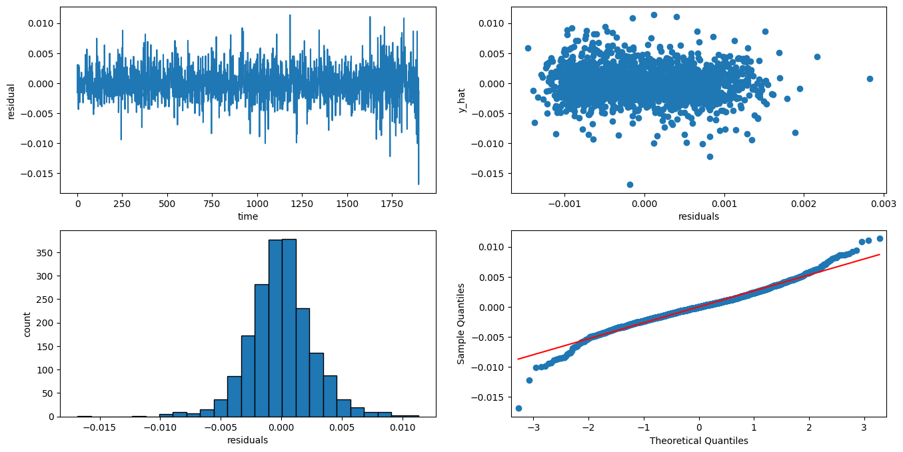
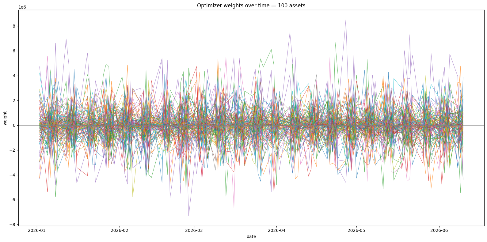
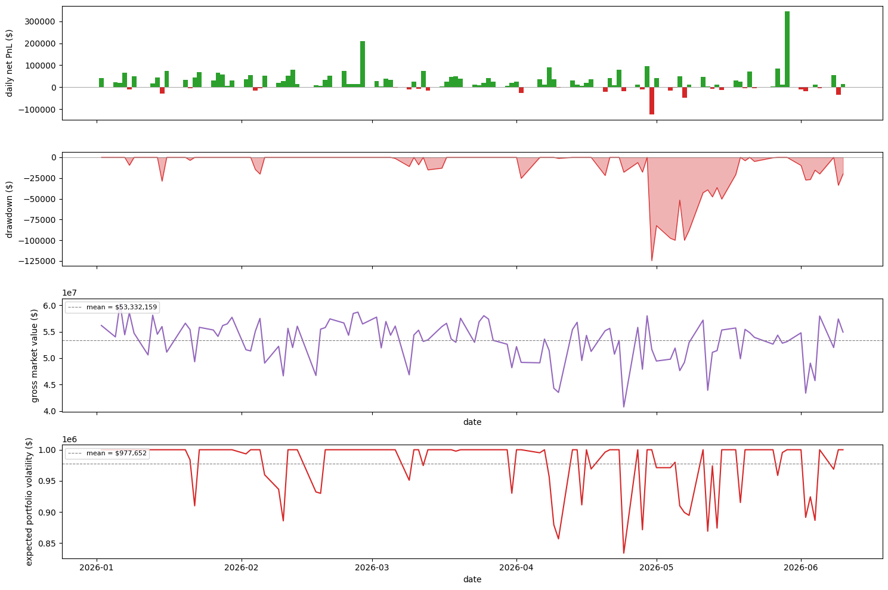
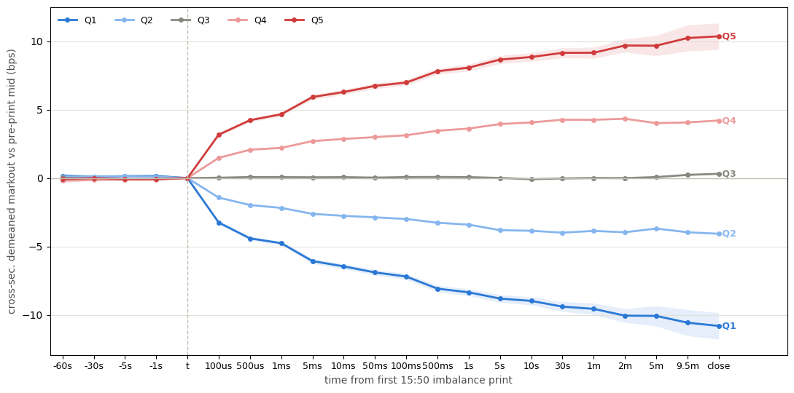

# Abstract

Each day, Nasdaq publishes auction imbalance information during the ten minutes leading up to the closing auction in order to attract liquidity and improve price discovery. In doing so it prints a mechanical signal that is learnable and strongly predictive of returns into the 16:00 close. We build a full trading system around this signal on the principles of classical statistical arbitrage: a forecast of 15:50 - 16:00 returns, a 10-factor covariance model, and a model of trading costs, assembled as the terms of a single-period maximization problem which is solved for an optimal portfolio of dollar holdings. Our features are time-series and cross-sectional transformations of signed dollar imbalance. We model return forecasts by boosting a lasso regression with xgboost, which robustly achieves a 29% average out-of-sample rank information coefficient through a rolling cross-validation. Backtested over 110 days, the strategy achieves a Sharpe ratio of 8.44 at a gross market-value of $60M. We argue that this elevated performance is expected given a high-IC forecast over a ten minute horizon, but also that there are tight limits on GMV capacity and latency, with diminishing marginal PnL above ~$60M in GMV and one third of the forecasted return realized within the first one hundred microseconds after the imbalance is disseminated. Given these constraints, we believe that this strategy would see the most success if integrated into an optimal execution pipeline serving a larger statistical arbitrage portfolio, allowing for consistent improvement while rebalancing large positions near the close.

# Motivation and Main Ideas {#sec-intro}

The Nasdaq equities closing auction occurs at 16:00:00 each trading day, and relevant auction information is published at a regular interval from 15:50:00 onward [@nasdaq4754]. At about 15:50:00, the exchange begins publishing information on the imbalance of auction orders. That is, the number of shares from on-close orders that will be left over after matching the maximum number of shares at the calculated auction execution price, as well as the side (buy/sell/none) of the leftover shares. The purpose of the auction imbalance publication is to attract auction liquidity to the opposite side of the imbalance, maximizing the number of shares executed and providing the best possible end-of-day price discovery. Therefore, a thesis exists: auction imbalance published from 15:50:00 through the close provides a mechanical signal that is learnable and strongly predictive of returns over that horizon. We will refer throughout to *dollar imbalance*, calculated as the number of imbalance shares multiplied by the exchange-estimated auction execution price at 15:50:00, signed by the side of the imbalance shares. Dollar imbalance and its time-series and cross-sectional transformations will be the basis of our return forecasts throughout.

# Methodological Choices and Innovations {#sec-methods}

This trading system is designed using optimal portfolio construction, the method underpinning classical statistical arbitrage. Given a single "period" or "horizon", we forecast per-asset returns, estimate their variance and covariance, and estimate the costs of trading. We then assemble these pieces as the terms of a maximization problem and solve for the optimal portfolio of dollar holdings $p^* \in \mathbb{R}^n$ over our horizon. The reason we use this framework is that it allows for non-trivial risk and cost dynamics to be accounted for in maximizing PnL over a given time horizon, such as factor-neutrality and hedging, lasso-like cost penalties, and instantaneous impact modeling. This problem is also DCP/SOCP, so it allows for free-access solvers such as Clarabel to efficiently solve. The decision to use a single horizon, rather than multiple, is discussed in @sec-single-vs-multi.

$$
\begin{split}
\max_p \quad &\underbrace{f \, p}_{\text{alpha}} - \underbrace{\frac{\lambda}{2} \, p^T \, \Sigma_r \, p}_{\text{risk}} - \underbrace{C(u)}_{\text{spread}} - \underbrace{I(u)}_{\text{impact}} \\ 
\text{s.t.} \quad & p \, L_{mkt} = 0 \\
                  & \sqrt{p^T \Sigma_r p} \leq \sigma_{\$}
\end{split}
$$ {#eq-simple-problem}

@eq-simple-problem is the maximization problem we solve each day, where $f \in  \mathbb{R}^n$ is a vector of return forecasts, $u = p - p_0, u \in \mathbb{R}^n$ is the vector of trades to be made over the horizon, $\Sigma_r \in \mathbb{R}^{n \times n}$ is a covariance matrix of returns, $C(u)$ is the cost of trading, and $I(u)$ is the instantaneous price impact of our trades. We discuss each term of the maximization problem, as well as the constraints, in detail in @sec-forecasting through @sec-optimization.

## Forecasting {#sec-forecasting}

### Features
<!-- Lasso + XGBoost (difficult to outperform the hero features) -->

The primary input for our trading system is a forecast of returns from 15:50 to the 16:00 closing auction. Making use of the strength of this signal, we take a keep-it-simple approach to modeling. We use two core features, and each is a transformation of signed dollar imbalance. One is a time series feature, which provides information across days, and one is cross-sectional, giving us information across assets, within days.

Firstly, we call our time series feature the "signed imbalance ratio". This is simply the signed dollar imbalance divided by an exponentially weighted moving average of past daily dollar volume. Second, for our cross-sectional feature we rank dollar imbalance across stocks each day, and divide by the auction participation, or the total liquidity available as limit-on-close orders as of 15:50. This ranking is then normalized using @eq-norm to arrive at our "normalized rank imbalance" feature which is constrained to the range [-1,1].

$$
\text{{norm rank}} = 2 \, \frac{(rank - min)}{(max - min)} - 1
$$ {#eq-norm}

The combination of these features gives us a strong indication of the assets most likely to move each day. We also used the cross-sectionally demeaned return from 15:45 to 15:50 as a signal of how much of the imbalance-driven return may have been realized just before the close, which could possibly lower the forecast magnitude.

### Models

The best forecasting model we found was a lasso regression combined with xgboost. We utilized this structure because our most powerful feature, the normalized rank imbalance, is inherently linear; however, the other features introduce weaker but significant non-linearity.

Using our two core features, as well as the demeaned pre-emptive return and interaction terms, we trained a lasso model [@tibshirani1996lasso] with $\alpha = 10^{-4}$. We then trained an xgboost model [@chen2016xgboost] on the same features against the lasso regression's residuals and combined them by subtraction (@eq-model). Using time series cross-validation, this model achieved an average IC across folds of 29%. @fig-diagnostics shows near-homoskedasticity and near-normally distributed residuals, a good indication of accuracy without overfitting.

$$
\begin{split}
\hat{\beta} = \min_{\beta} \quad &\frac{1}{2} |y - X \beta|_2^2 + | \alpha \beta |_1 \quad \text{(lasso problem)} \\ 
\hat{f} &= X \hat{\beta} - \text{xgboost}(X)
\end{split}
$$ {#eq-model}

{#fig-diagnostics}

## Covariance Estimation {#sec-covariance}
<!-- Factor modeling, centering and volatility scaling -->

We represent $\Sigma_r$ using a factor model of standardized returns. We first volatility-adjust the $T \times n$ returns matrix $X$ into $\tilde{X}$ using a causal EWMA volatility estimate (lagged one day for causality), and take the best rank-10 singular value decomposition $\tilde{X} \approx U_{10} S_{10} V_{10}^{T}$. Because $\tilde{X}$ is unitless, the resulting loadings and residual variances must be mapped back into return units before the optimizer can use them. We do this with $C = \mathrm{Diag}(\mathrm{std}(X))$, the diagonal matrix of per-asset sample return volatilities, at the final computation of $\Sigma_r$ using the unitless $\tilde{\Sigma}$ so that $\Sigma_r$ carries units of squared daily return. The full model is estimated on daily bars over 2023-06-01 to 2025-06-01, a window deliberately disjoint from the 2025-06-11 to 2026-06-11 period over which the forecast and backtest run, so the covariance is used strictly out of sample.

$$
\begin{split}
&C = \mathrm{Diag}(\mathrm{std}(X)) \in \mathbb{R}^{n \times n}
\qquad
F = U_{10} \\
&L = S_{10} \, V_{10}^T
\qquad
D = Diag(var(\tilde{X} - F \, L)), \quad D \in \mathbb{R}^{n \times n} \\
\quad &\Rightarrow \Sigma_F = \frac{1}{T-1} F^T \, F \\
      &\Rightarrow \tilde{\Sigma} = L^T \, \Sigma_F \, L + D \\
      &\boxed{\Sigma_r = C^T \, \tilde{\Sigma} \, C}
\end{split}
$$ {#eq-covariance}

Compared with the sample covariance matrix $\Sigma$, using this factor model of returns increases accuracy and drastically reduces numerical issues in solving for $p^*$. Empirically, we have found that the condition number of sample covariance is on the order of $10^5$ and it is not positive semi-definite (PSD), while the factor-modeled $\Sigma_r$ has a condition number on the order of $10^2$, and is PSD. It also allows us to use factor-neutrality constraints in the optimizer, discussed further in @sec-optimization, which prevents accidental concentration of risk along any particular direction of return variance. Without this model, the optimizer would run into numerical issues solving, and the integrity of the solve would be questionable at best due to very small eigenvalues leading to unrealistic near-zero risk directions that the optimizer would leverage heavily.

## Price Impact Modeling {#sec-impact}
<!-- Reference bouchaud papers and square-root impact model, tried different parameter values from 0 to 1.
Instantaneous impact only. -->

We model price impact as a volatility-adjusted square-root impact model [@toth2011anomalous], as in @eq-impact. Rather than fitting values for the impact parameter $\gamma$ per asset, we experimented with multiple scalar values from the range [0, 1], anchored around $\gamma \approx 0.15$ estimated by [@almgren2005direct] using institutional trading data from Citigroup. Since we are working on a ten-minute horizon with one round-trip trade that is latency constrained, we assume that the only impact cost is instantaneous or temporary impact [@almgren2001optimal].

$$
\underbrace{I}_{\text{return impact}} \;=\; \gamma \; \sigma \;
\sqrt{\dfrac{u}{\mathrm{ADV}}}
$$ {#eq-impact}

where $\sigma \in \mathbb{R}^n$ is a vector of asset volatilities, $u = | p - p_0 | \in \mathbb{R}^n$ are the absolute value of trades, and $\mathrm{ADV} \in \mathbb{R}^n$ is an EWM of daily dollar volume.

## Optimizer {#sec-optimization}
<!-- Single period MVO + spread cost + instantaneous impact. -->

As mentioned in @sec-methods, we make use of classical statistical arbitrage machinery to estimate the optimal dollar holdings over our trading horizon. The full maximization problem is stated in @eq-full-problem. We use a single-period MVO along with spread cost and instantaneous impact terms, and use CVXPY [@diamond2016cvxpy] to independently solve for the optimal dollar portfolio over each period. At each period we solve the @eq-full-problem where $u = p$ since each portfolio is initially $p_0 = 0$.
$$
\begin{split}
\max_p \quad &f \, p - \frac{\lambda}{2} \, p^T \, \Sigma_r \, p - \frac{s}{2} |p| - \gamma \, \sigma \, \dfrac{|p|^{3/2}}{\sqrt{\mathrm{ADV}}} \\ 
\text{s.t.} \quad & p \, L_{mkt} = 0 \\
                  & \sqrt{p^T \Sigma_r p} \leq \sigma_{\$}
\end{split}
$$ {#eq-full-problem}

We also subject our optimal portfolio to factor-neutral constraints, specifically neutrality against the factor of largest variance (the market factor) derived from the earlier SVD, and to expected dollar volatility constraints. This strategy is less sensitive to volatility than to costs and impact, since this is a relatively fast strategy with high feature ICs; however the factor-neutrality guarantee enforces a reliance only on forecasted returns, not market movements generally. The expected dollar volatility ensures that the portfolio is never expected to move by more than some cap, which helps control risk and prevents the optimizer from suggesting a rapid increase in GMV.

# Empirical Results {#sec-findings}

## Backtest {#sec-backtest}
<!-- Really really good backtest. Every thing seems real. -->
We conduct our backtest over 110 days from [2026-01-01, 2026-06-11], and we attempt to get a best estimate of the Sharpe ratio of this strategy at its full-capacity GMV limit. Recall from @sec-data that the forecasting model was trained on [2025-06-11, 2025-12-31] and the covariance model on daily data from [2023-06-01, 2025-06-01]. The parameters for this run are in @tbl-params and results are reported in @tbl-results and @fig-backtest. Although such a high Sharpe ratio may be met with skepticism, the assumptions leading to such performance and the constraints inherent to it are discussed in @sec-capacity.

| Parameter | Value | Desc. |
|-----------|:------|:------:|
| Lambda      | $10^{-8}$  | Risk param. on the order of ~ 1 / GMV|
| Gamma       | 0.15  | Impact param. ranging from [0, 1].   |
| Volatility Cap | $10^{6}$   | Expected portfolio volatility cap ($).   |
: Backtest Parameters {#tbl-params}



| Result | Value |
|-----------|:------|
| Mean GMV        | $53M   |
| Max. GMV        | $60M   |
| Sharpe          | 8.44   |
| Gross PnL       | $5.0M  |
| Spread Cost     | $1.0M  |
| Impact Cost     | $1.2M  |
| Net PnL         | $2.8M  |
| Exp. Volatility | $1.0M  |
| Max. Drawdown   | -$125K |
: Backtest Results {#tbl-results}


<!-- {#fig-weights} -->

{#fig-backtest}

At these and similar parameter values, the optimizer produces relatively stable performance and gross market-value (GMV). It has shallow drawdowns and a high Sharpe ratio, with small but consistent gains. Testing GMVs above this maximum GMV of ~$60M leads to diminishing marginal PnL.

## Capacity and Execution Constraints {#sec-capacity}
<!-- This is constrained to max capacity under $100M, likely $40-60M GMV, with peak returns reached much earlier. This is due to the short horizon constraining the ability to chunk orders, and the latency requirements of the signal, and the relatively small size of auction imbalances.

This would require exceptional execution quality and speed, as most of the forecasted return happens in the first 250ms after the imbalance is first printed by the exchange. -->
This strategy's performance in @sec-backtest is phenomenal, and may seem overstated or raise alarm of bias or error. However, this level of performance is to be expected in any strategy using high IC features over a short horizon. It is important to understand the conditions for such strategies to work, though. The crucial thing is that this alpha is subject to serious capacity and execution constraints.

Firstly, given the short timeframe of trading, the capacity of this alpha is constrained to GMVs below ~$60M. Since we are effectively dumping the entire capacity into and out of the market at one instant around 15:50 and the closing auction, we have high instantaneous impact. The nature of our exit strategy also being MOC orders opposite to the auction imbalance means that our trading reduces the effect of the imbalance on price, so we are doubly constrained. 

Given the high price impact, we may be inclined to spread out trades over the ten minute window; however, two things prevent this. First, Nasdaq only accepts MOC orders until 15:55 [@nasdaq4754], so the exit MOC orders must be placed before then, restricting us to five minutes of trading. More importantly though, @fig-markout shows about one third of the forecasted return from 15:50 - close is realized within the first $100\mu\text{s}$ after Nasdaq first disseminates the auction imbalance, and two thirds within the first 5ms. This means that the strategy is stuck with high price impact and that orders must be able to reach the exchange within $100\mu\text{s}$ or else the alpha is too small to justify costs. This also means that in practice, the staggered nature of live messages leads to the risk that early arrivals' forecasted returns become realized before the entire universe has reported feature values.

{#fig-markout}


# Future Work {#sec-future}

<!-- Future work would include improving the forecast as well as studying overnight signals. Possibly adding a second period from 15:55-15:58 when continuous and LOC orders are accepted. Improving impact estimation. Developing an execution simulator to test for implementation shortfall and more exact latency requirements. -->

The main areas for further research in this strategy are, as always, improving current forecasts and adding new ones. Most important would be adding a forecast of overnight returns. A likely first-pass improvement would be modeling the reversion of close auction returns into the next-day open. This would improve the strategy's capacity and PnL by lengthening the alpha's horizon and allowing for better management of price impact. This would also necessitate overnight volatility modeling.

As it stands, this system is a high-Sharpe, low-capacity opportunity. We believe that it would likely achieve the most success as part of an optimal execution pipeline within a larger, longer-horizon statistical arbitrage system. This way, the relatively small but consistent alpha demonstrated here can be captured while rebalancing larger positions near the closing auction.

```{=latex}
\appendix
```
# Appendix

## Data {#sec-data}
<!-- Databento imbalance, tbbo, and statistics (official auction) from XNAS.ITCH. -->

Throughout this work we use a combination of daily statistics, trades and BBO, and imbalance data. All data used here is sourced through Databento's XNAS.ITCH dataset [@databento]. The exception to this is expensive corporate-action adjustment factors, which are sourced via yfinance [@yfinance] and sometimes inferred via Databento's daily data. Model fitting uses scikit-learn [@pedregosa2011scikit] and xgboost [@chen2016xgboost].

We chose to use one year of trades, BBO, and imbalance data from 2025-06-11 through 2026-06-11 in order to minimize expense and memory complexity. We split into train [2025-06-11, 2025-12-31] and test [2026-01-01, 2026-06-11] ranges and also use CAX-adjusted daily data from [2023-06-01, 2025-06-01] for the covariance modeling. The train/test split allowed us to avoid the difficult machinery of rolling-universe selection and instead use a single static universe of the 100 highest ADV Nasdaq equities from the train set.

## Single vs Multi Period Optimization {#sec-single-vs-multi}
<!-- 10 minute signal, only one forecast, rebalancing would cost more than it's worth. -->
The decision to use a "myopic" single-period optimizer instead of optimizing over a multi-period position path [@boyd2017multiperiod] was driven by the nature of the alpha forecast we are using. The ten-minute horizon leaves little opportunity to trade and so frequent rebalancing costs more than our alpha forecast can overcome. If overnight forecasts are later developed (see @sec-future) we would recommend moving toward multi-period planning to reduce price impact.

# References {.unnumbered}

::: {#refs} :::