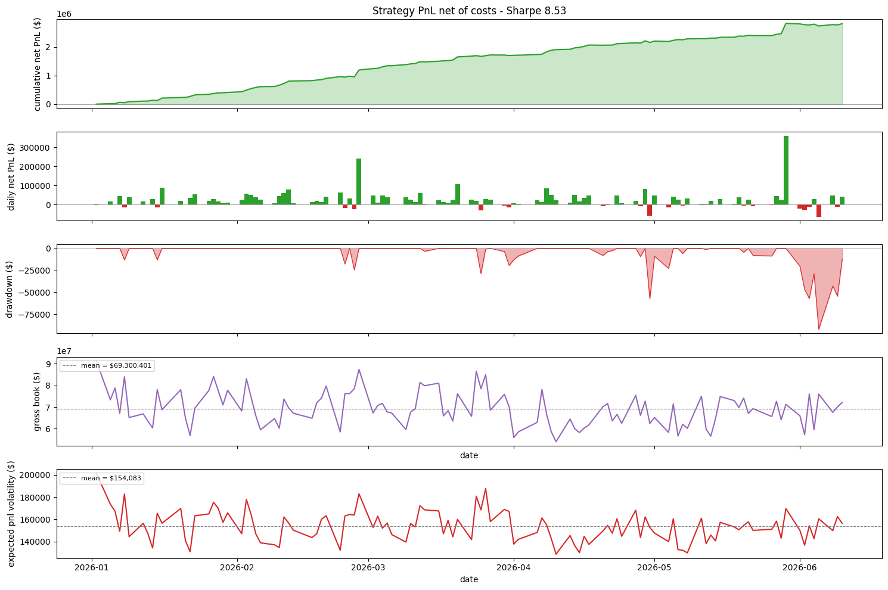

# Abstract

The Nasdaq closing auction publishes its order imbalance from 15:50:00 onward in order to attract liquidity to the opposite side, and in doing so it prints a mechanical signal that is learnable and strongly predictive of returns into the 16:00 close. We build a full trading system around this signal on the principles of classical statistical arbitrage: a forecast of 15:50 - 16:00 returns, a covariance estimate, and a model of trading costs, assembled as the terms of a single-period maximization problem and solved for an optimal portfolio of dollar holdings. Our forecast is a lasso regression which is gradient-boosted by xgboost. Our features are time-series and cross-sectional transformations of signed dollar imbalance, which achieves a 26% average rank information coefficient through cross-validation. We estimate risk with a rank-10 factor model of causally standardized returns, and we include spread costs and an Almgren-Chriss square-root instantaneous impact model. Backtested over 110 days, the strategy has a Sharpe ratio of ~8.5. We argue that this performance is what should be expected of a high-IC signal over a ten minute horizon, and that the real limits on the strategy are capacity and execution: GMV is constrained to below ~\$80M, and most of the forecast return arrives within the first few seconds after the imbalance begins dissemination, making institutional grade execution and latency a prerequisite to implementation.

# Motivation and Main Ideas {#sec-intro}

The Nasdaq equities closing auction occurs at 16:00:00 each trading day, and relavent auction imformation is published at a regular interval from 15:50:00 onward. At 15:50:00, the exchange begins publishing information on the imbalance of auction orders, that is, the amount of shares that will not be executed at the current auction execution price, and the side (buy/sell/none) of the imbalance. The purpose of the auction imbalance publication is to attract auction liquitidy to the opposite side of the imbalance, maximizing the number of shares executed and providing the best possible end-of-day price discovery for the market. Therefore, a thesis exists: auction imbalance 15:50:00 - 16:00:00 provides a mechanical signal that is learnable and strongly predictive of returns over that horizon. We will refer throughout to *dollar imbalance*, calculated as the number of imbalance shares multiplied by the exchange-estimated auction execution price at 15:50:00, signed by the side of the imbalance shares. Dollar imbalance and its time-series and cross-sectional convolutions will be the basis of our return forecasts throughout.

# Methodological Choices and Innovations {#sec-methods}

This trading system is designed using the principles underpinning classical statistical-arbitrage via portfolio construction. Given single "period" or "horizon", we forecast per-asset returns over the full period, estimate their variance and covariance, and estimate the costs of trading. We then assemble these pieces as the terms a maximization problem and solve for the optimal portfolio of dollar holdings $p^* \in \mathbb{R}^n$ over the horizon. The reason we use this framework is that it allows for non-trivial risk and cost dynamics to be accounted for in maximizing pnl over a given time horizon, such as factor-neutrality and hedging, L1-like cost penalties, and instananeous impact modeling. This problem is also DCP/SOCP, so it allows for free-access solvers such as Clarabel to efficiently solve. 

$$
\begin{split}
U(p) &= fp - p^T \Sigma_r p - C(u) - I(u) \\ 
p^*  &= \text{max(p) s.t. Constraints}
\end{split}
$$

Above is the maximization problem, where $u = p - p_0, u \in \mathbb{R}^n$ is the vector of trades to be made over the horizon, $C(u)$ is the cost of trading, and $I(u)$ is the instantaneous price impact of trading. We discuss each term of the maximization problem, as well as the constraints, in detail in @sec-forecasting through @sec-optimzation.

## Forecasting {#sec-forecasting}

### Features

<!-- Ridge vs Lasso vs Lasso + XGBoost (difficult to outperform the hero features) -->
To be input into the optimization problem we have structued, we need a forecast of returns from 15:50 to the 16:00 closing auction. We use as our features multiple transformations of the signed dollar imbalance information published by the exchange, which has a 29% rank information coefficient (IC) over this horizon. Making use of the strength of this signal, we take a keep-it-simple approach to modeling. Our core features are each derivatives of signed dollar imbalance, one time series and one cross-sectional. This gives us information about both day-to-day and asset-to-asset "surprises" that may be good signals. 

First, the time series feature is the signed imbalance ratio, which is simply the signed dollar imbalance divided by an exponentially weighted moving average of past daily dollar volume. Second, the cross-sectional feature is a ranking of dollar imbalance divided by the auction participation, or the total liquidity available as limit-on-close orders as of 15:50. This ranking is then normalized using its bounds, as

$$
\text{{norm rank}} = \frac{rank - min}{2(max - min)} - 1
$$

This cross-sectional feature gives us a strong indication of the assets most likely to move each day. We also used the cross-sectionally demeaned return from 15:45 to 15:50 as a signal of how much of the imbalance-driven return may have been preempted just before the close.

### Models

The best forecasting model we found was a lasso regression boosted using xgboost. We utilized this structure because our most powerful feature, the normalized rank imbalance, is inherently linear, however the other features introduce weaker but significant non-linearity.

Using the normalized rank imbalance as well as the imbalance volume ratio, and an interaction term, we trained a lasso model with $\alpha = 10^-4$ and an xgboost model on the regression's residuals, and used kfold validation with 8 folds. Using this model we achieved an average IC across folds of 26%. Below is a set of diagnostic plots of the residuals.

{#fig-diagnostics}

## Covariance Estimation {#sec-covariance}

<!-- Factor modeling, centering and volatility scaling -->
The covariance matrix $\Sigma_r$ is the sole way that the optimzation system represents the variance and covariance of different securities and positions. It uses this information to both quantify the risk (variance) of holding a given security, and to hedge positions against each other (covariance) and achieve factor neutralities.

We represent $\Sigma_r$ using a factor model of standardized returns. To do this, we first causally center and volatility-adjust the returns matrix $X$ into $\tilde{X}$ and take the best rank-10 singular-value decompisition $\tilde{X} = U_{10} D_{10} V_{10}^T$. Using this SVD, we can construct a factor model of returns. We also use the variance of $\tilde{X}$, called $S$, to transform the factor mdoel back into true returns, rather than a returns over variance, so that it cna be correctly used in the optimizer.

$$
\begin{split}
S = var(\tilde{X}) \in \mathbb{R^n}
\qquad
&F = U_{10} \\
L = D_{10}V_{10}^T S
\qquad
&\epsilon = Diag(var(\tilde{X} - F L)) S \\
\Rightarrow \Sigma_F = \frac{1}{n-1} F^T F \\
\Rightarrow \Sigma_r = L^T \Sigma_F L + \epsilon \\
\end{split}
$$

Using this factor model of returns drastically reduces numerical issues involved in solving for $p^*$, when compared with the sample covariance matrix $\Sigma$. Empirically, we have found that the condition number of $\Sigma$ is on the order of $10^5$ and is not positive semi-definite (PSD), while the factor-modeled $\Sigma_r$ has condition number on the order of $10$, and is PSD. It also allows us to use factor neutrality constraints in the optimizer, preventing accidental concetration of risk along any particular direction of returns variance. Without this model, the optimizer would run into numerical issues solving, and the integrity of the solve would be questionable at best due to very small eigenvalues leading to unrealistic near-zero risk directions that the optimizer leverages heavily.

## Price Impact Modeling {#sec-impact}

<!-- Reference bouchaud papers and square-root impact model, tried different parameter values from 0 to 1.
Instantaneous impact only. -->
Price impact is modeled as an Almgren - Chris square root impact model, as below. Rather than fitting values for the impact parameter $\gamma_i$ per asset, we experimented with multiple values and verified the optimizer's behavior in @sec-hyperparams. Since we are working on a ten minute horizon with one round-trip trade that is latency restricted, we assume that the only impact cost is instantaneous impact, modeled below.

$$
\underbrace{I_i}_{\text{return impact}} \;=\; \gamma_i \; \sigma_i \;
\sqrt{\dfrac{Q^{\$}_i}{\mathrm{ADV}^{\$}_i}},
\qquad
\underbrace{\text{cost}_i}_{\text{\$}} \;=\; \gamma_i \; \sigma_i \;
\dfrac{|Q^{\$}_i|^{3/2}}{\sqrt{\mathrm{ADV}^{\$}_i}}.
$$

## Optimizer {#sec-optimzation}

<!-- Single period MVO + spread cost + instantaneous impact. -->
The optimization system used for this strategy is based on the statistical arbitrage principles of optimal portfolio construction. Here we utilize a single-period MVO along with a spread cost and instantaneous impact terms, and use CVXPY to independently solve for the optimal dollar portfolio over each period. At each period we solve the below problem.

$$
\begin{split}
U(p) &= fp - p^T \Sigma_r p - \frac{s}{2} |p| - \dfrac{|Q|^{3/2}}{\sqrt{\mathrm{ADV}}} \\ 
p^*  &= \text{max(p) s.t. Constraints}
\end{split}
$$

We also subject our optimal portfolio to factor neutral constraints, specifically neutrality against the factor of largest variance (the market factor) derived from the earlier SVD, and to expected dollar volatility constraints. These have a smaller but significant effect than impact, since this is a relatively fast and cost-constrained strategy with high feature ICs, so covariance is a smaller concern.

$$
\begin{split}
p \, L_{mkt} &= 0 \\
\sqrt{p^T \Sigma_r p} &\leq \sigma_{\$}
\end{split}
$$

# Empirical Results {#sec-findings}

## Backtest {#sec-backtest}
<!-- Really really good backtest. Every thing seems real. -->
We conduct our main backtest over 110 days from [2026-01-01, 2026-06-11]. Recall from @sec-data that the forecasting model was trained on [2025-06-11, 2025-12-31] and the covariance model on daily data from [2023-06-01, 2026-01-01]. The sharpe ratio over this time period of ~8.5 is relatively high, subject to constraints discussed in @sec-capacity. The parameters for this run are in @tbl-params, the daily dollar portfolio weights are in @fig-weights, and the results are in @fig-backtest.

| Parameter | Value | Desc. |
|-----------|:------|:------:|
| Lambda      | 1e-6  |Risk param. on the order of ~ 1 / GMV|
| Gamma       | 0.15  |Impact param. ranging from [0, 1].   |
| exp_vol_cap | 3e6   |Expected portfolio volatility cap.   |

: Backtest Parameters {#tbl-params}

{#fig-weights}

{#fig-backtest}

At these and similar parameter values, the optimizer produces relatively stable performance and gross market-value (GMV). It has very slight drawdowns and very high sharpe, with small but consistent gains. Although this may ring alarm bells, it is to be expected with this type of alpha and will be furthur discussed in @sec-capacity.

## Capacity and Execution Constraints {#sec-capacity}
<!-- This is constrained to max capacity under $100M, likely $40-60M GMV, with peak returns reached much earlier. This is due to the short horizon constraining the ability to chunk orders, and the latency requirements of the signal, and the relatively small size of auction imbalances.

This would require exceptional execution quality and speed, as most of the forecasted return happens in the first 250ms after the imbalance is first printed by the exchange. -->
This strategy's performance in @sec-backtest is phenomenal, and may seem overstated of raise alarm of bias or error. However, this level of performance is to be expected in such a strategy using high IC features over a short horizon. The crucial thing is that this alpha is subject to serious capacity and execution constraints.

Firstly, given the short timeframe of trading, the capacity of this alpha is constrained to GMVs below ~$80M. Since we are effectively dumping the entire capacity into and out of the market at one instant around 15:50 and the close, we have a high instantaneous impact. The nature of our exit strategy also being MOC orders opposite to the auction imbalance means that our trading reduces the affect of the imbalance on price, so we are doubly constrained. 

We may be inclined to spread our trading out over the ten minute window, however, two things prevent this. First, NASDAQ only accepts MOC orders until 15:50, so the exit MOC orders must be placed before then, restricting us to five minutes of trading. More importantly though, on average most fo the forecast return from 15:50 - 16:00 close actually happens within the first few seconds after the auction imbalance begins dissemination at 15:50:00. This means that the strategy is stuck with high price impact and that institutional grade execution and latency is a prerequisite.

# Future Work {#sec-future}

<!-- Future work would include improving the forecast as well as studying overnight signals. Possibly adding a second period from 15:55-15:58 when continuous and LOC orders are accepted. Improving impact estimation. Developing an execution simulator to test for implementation shortfall and more exact latency requirements. -->

The main areas for further research in this strategy are, as always, improving current forecasts and adding new ones. Most important would be adding a forecast of overnight returns. A likely first-pass improvement would be modeling the reversion of close auction returns into the next-day open. This would improve the strategy's capacity and pnl by lengthening the alpha's horizon and allowing for better management of price impact. This would also necessitate overnight volatility modeling.

# Appendix {#sec-appendix}

## Data {#sec-data}
<!-- Databento imbalance, tbbo, and statistics (official auction) from XNAS.ITCH. -->

Throughout this work we use a combination of daily [statistics](https://databento.com/docs/schemas-and-data-formats/statistics?historical=python&live=python&reference=python), [L1 trades and BBO](https://databento.com/docs/schemas-and-data-formats/tbbo?historical=python&live=python&reference=python) data, and [L3 imbalance data](https://databento.com/docs/schemas-and-data-formats/imbalance?historical=python&live=python&reference=python). All data used here is sourced through [Databento](https://databento.com/docs/schemas-and-data-formats/mbp-10?historical=python&live=python&reference=python), and their XNAS.ITCH dataset. The exception is expensive corporate-action adjustment factors which are sourced via yfinance and sometimes inferred via Databento's daily data. 

We chose to use one year of trades, BBO, and L3 imbalance data (to minimize expense and memory complexity) from 2025-06-11 through 2026-06-11. We split into train [2025-06-11, 2025-12-31], and test [2026-06-01, 2026-06-11] ranges and also use CAX-adjusted daily data from [2023-06-01, 2026-01-01] for the covariance modeling. The train/test split allowed us to avoid rolling-universe selection difficulties and instead use a single static universe of the 500 highest ADV Nasdaq equities from the train set.

## Single vs Multi Period Optimization {#sec-single-vs-multi}
<!-- 10 minute signal, only one forecast, rebalancing would cost more than it's worth. -->
The decision to use "myopic" single period optimization instead of optimizing over a position path was driven by the nature of the alpha forecast we are using. The horizon being only 10mins means we have very little opportunity to trade and that our forecasts are more accurate but also smaller than daily forecasts. In turn, this means we have few opportunities to trade adn that rebalancing and hedging costs more than it is worth. If overnight forecasts are later developed (see @sec-future) we recommend a re-development toward multi-period planning to reduce price impact.

# References

Almgren, R., and N. Chriss (2000). "Optimal Execution of Portfolio Transactions." *Journal of Risk* 3 (2): 5–39. <https://doi.org/10.21314/JOR.2001.041>

Almgren, R., C. Thum, E. Hauptmann, and H. Li (2005). "Direct Estimation of Equity Market Impact." *Risk* 18 (7): 58–62.

Tóth, B., Y. Lempérière, C. Deremble, J. de Lataillade, J. Kockelkoren, and J.-P. Bouchaud (2011). "Anomalous Price Impact and the Critical Nature of Liquidity in Financial Markets." *Physical Review X* 1 (2): 021006. <https://doi.org/10.1103/PhysRevX.1.021006>

Boyd, S., E. Busseti, S. Diamond, R. N. Kahn, K. Koh, P. Nystrup, and J. Speth (2017). "Multi-Period Trading via Convex Optimization." *Foundations and Trends in Optimization* 3 (1): 1–76. <https://doi.org/10.1561/2400000023>

Bogousslavsky, V., and D. Muravyev (2023). "Who Trades at the Close? Implications for Price Discovery and Liquidity." *Journal of Financial Markets* 66: 100852. <https://doi.org/10.1016/j.finmar.2023.100852>

`